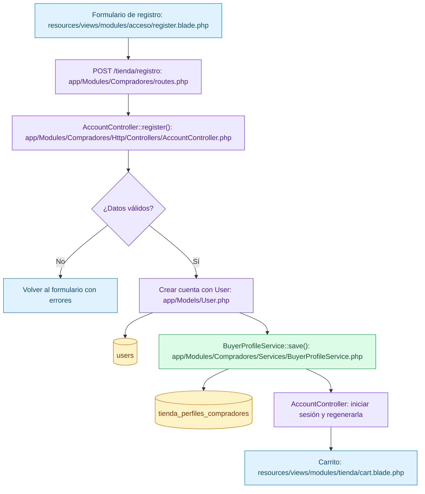
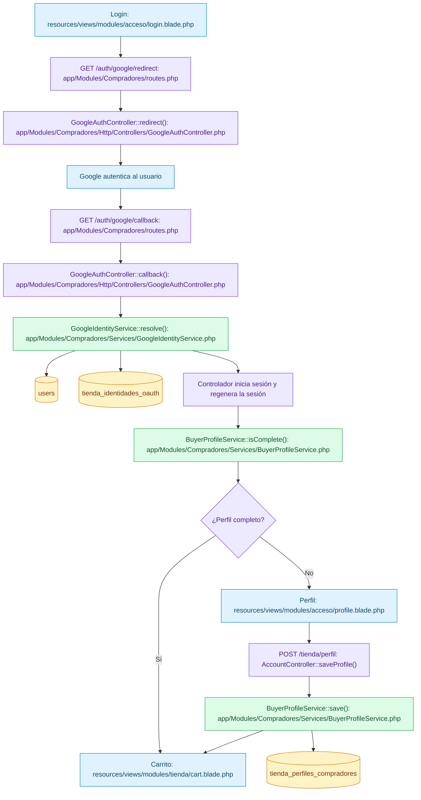
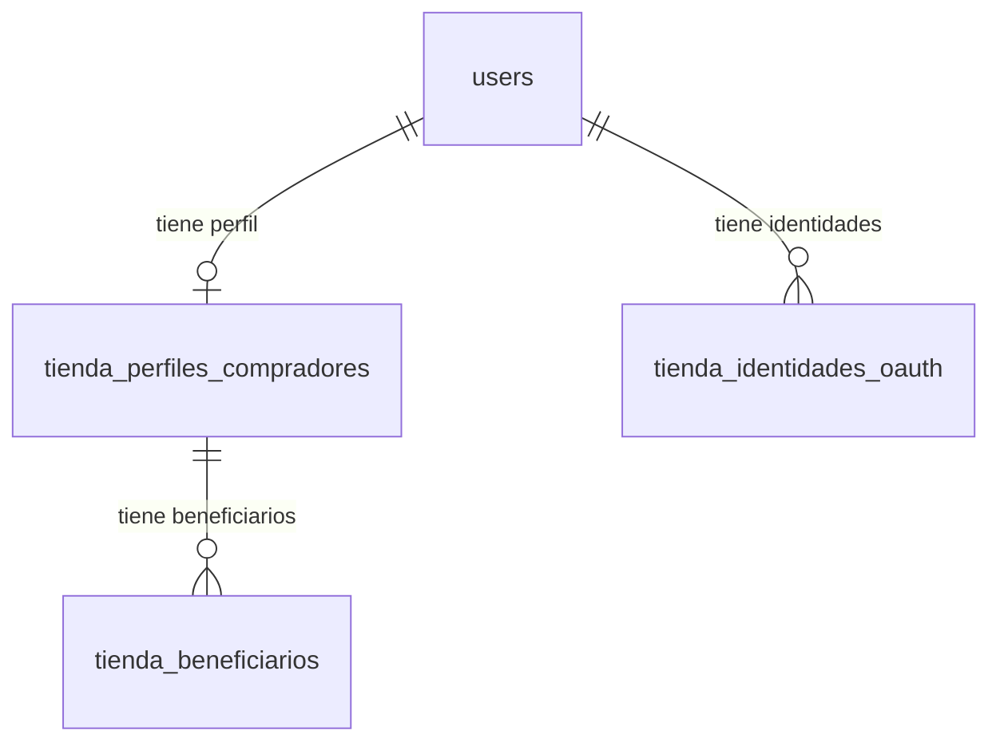

# Compradores: flujo de frontend, backend y base de datos

Fecha: 9 de noviembre de 2026.

El módulo permite registrar compradores, iniciar sesión con contraseña o Google y completar su perfil antes de continuar al carrito.

**Validación reportada por el responsable del proyecto:** registro, login y perfil probados como usuario; se comprobó la creación de cuentas en `users`. Esto no constituye una validación de pagos, beneficiarios ni de todos los escenarios de error. Esta documentación describe el código revisado; no implica una ejecución nueva de pruebas ni una inspección directa del servidor.

## Cómo leer los flujos

Las rutas de archivos parten de la raíz del repositorio. Azul representa interfaz; morado, controladores; verde, servicios; amarillo, tablas.

El navegador envía solicitudes HTTP (HTTPS cuando el sitio está configurado para ello). Los formularios web de registro, login y perfil usan POST con protección CSRF y reciben redirecciones; no todas las solicitudes son JSON. Las API del perfil sí responden JSON. Dentro de Laravel, controlador y servicio se comunican mediante llamadas PHP.

Laravel recibe las solicitudes mediante `public/index.php`, carga su configuración y aplica los middleware correspondientes. `routes/web.php` incorpora `app/Modules/Compradores/routes.php`; Laravel busca allí la ruta que debe atender la solicitud.

## 1. Registro con contraseña

1. El controlador normaliza el correo y valida datos personales, correo único y contraseña confirmada de al menos 12 caracteres.
2. `AccountController::register()` crea directamente el usuario mediante el modelo `User`, que almacena la contraseña como hash.
3. Llama a `BuyerProfileService::save()` para guardar el perfil.
4. Cuenta y perfil se crean dentro de una transacción: un fallo revierte las escrituras de esa operación.
5. El controlador inicia sesión, regenera la sesión y redirige a `/tienda/carrito`.

Si ya existe una sesión, el registro redirige a `/tienda/perfil`.

## 2. Login con contraseña

| Paso | Archivo y función | Resultado |
|---|---|---|
| Formulario | `resources/views/modules/acceso/login.blade.php` | POST a `/tienda/login` con CSRF. |
| Ruta | `app/Modules/Compradores/routes.php` | Ejecuta `AccountController::login()`. |
| Autenticación | `app/Modules/Compradores/Http/Controllers/AccountController.php` | Valida los campos y usa `Auth::guard('web')->attempt()` para autenticar la cuenta de `users`. |
| Error | Mismo controlador | Regresa al formulario con error de credenciales. |
| Éxito | Mismo controlador | Regenera la sesión y consulta `BuyerProfileService::isComplete()`. |
| Destino | Perfil completo: carrito; incompleto: perfil | Redirige a `/tienda/carrito` o `/tienda/perfil`. |

## 3. Acceso con Google y perfil

- Socialite gestiona la redirección y el callback OAuth con estado. Google debe estar habilitado y configurado; el controlador exige HTTPS.
- `resolve()` verifica el identificador del proveedor y el correo verificado. Busca por proveedor e identificador de Google.
- Si la identidad existe, recupera el usuario y comprueba coherencia del correo.
- Si es nueva y no hay conflicto, crea `users` y `tienda_identidades_oauth` dentro de una transacción.
- No vincula automáticamente una identidad nueva a una cuenta existente solo por coincidencia de correo. Los errores vuelven al login con un mensaje.
- El controlador conserva nombres de Google en sesión para completar el formulario y comprueba el perfil.
- `saveProfile()` valida datos, llama al servicio, limpia el prellenado de sesión y redirige al carrito.
- Google no acredita DNI, matrícula, condición de estudiante ni permisos internos. El registro no concede roles.

## 4. Perfil mediante API

| Método y dirección | Función en BuyerProfileController | Servicio |
|---|---|---|
| GET `/api/v1/acceso/estado` | `state()` | `isComplete()` y `find()`. |
| GET `/api/v1/acceso/perfil` | `show()` | `find()`. |
| PUT `/api/v1/acceso/perfil` | `update()` | Valida y llama a `save()`. |

Controlador: `app/Modules/Compradores/Http/Controllers/BuyerProfileController.php`.

Servicio: `app/Modules/Compradores/Services/BuyerProfileService.php`.

Estas rutas requieren sesión autenticada y tienen límite de solicitudes. La identidad del comprador proviene de la sesión, no de un `user_id` enviado por el navegador. El frontend puede consumirlas desde `public/js/undc-tienda.js`. El controlador convierte los resultados PHP en JSON y JavaScript actualiza la interfaz.

## 5. Tablas del módulo

| Tabla | Responsabilidad | Alcance del código documentado |
|---|---|---|
| `users` | Cuenta del comprador y credenciales. | Registro y autenticación. |
| `tienda_perfiles_compradores` | Datos personales y contacto. | Consulta, guardado y comprobación de completitud. |
| `tienda_identidades_oauth` | Vínculo entre usuario y proveedor Google. | Resolución de identidades. |
| `tienda_beneficiarios` | Beneficiarios asociados al perfil. | Estructura preparada; no se documenta como flujo funcional implementado. |

Las tablas viven en la base de datos configurada del servidor, no en carpetas PHP. Sus definiciones están en `database/migrations/`: migración inicial de usuarios, `2026_10_25_000001_create_undc_identity_and_catalog_tables.php` y renombrado incremental `2026_11_09_000001_rename_store_business_tables_to_spanish.php`.

Los compradores de `users` son distintos del personal histórico de `tm_usuario`.

## 6. Límite del módulo

Compradores deja al usuario autenticado y con su perfil guardado. No crea pedidos ni confirma pagos. La redirección al carrito continúa en Pedidos.

[Volver al módulo Compradores](../app/Modules/Compradores/README.md) · [Modelo de datos de Compradores](./modelo-datos/03_COMPRADORES.md)
