# Diagrama general por siete módulos — 44 tablas

**Monolito modular + DDD ligero.** Un único esquema MariaDB y siete propietarios lógicos. Cada bloque representa un límite de responsabilidad; los colores no representan bases independientes. Las flechas representan claves foráneas documentadas, no mensajes JSON.

```mermaid
flowchart LR
  subgraph Sispagos["SISPAGOS (legado) · 6"]
    tm_oficina["tm_oficina"]
    tm_rol["tm_rol"]
    tm_usuario["tm_usuario"]
    tm_conceptos["tm_conceptos"]
    tm_recaudacion["tm_recaudacion"]
    tm_resultado["tm_resultado"]
  end
  style Sispagos fill:#E1E6ED,stroke:#64748b,stroke-width:2px,color:#111827
  subgraph Catalogo["Catálogo · 4"]
    tienda_categorias["tienda_categorias"]
    tienda_configuracion_oficinas["tienda_configuracion_oficinas"]
    tienda_conceptos_catalogo["tienda_conceptos_catalogo"]
    tienda_versiones_tarifas["tienda_versiones_tarifas"]
  end
  style Catalogo fill:#DDF4E5,stroke:#64748b,stroke-width:2px,color:#111827
  subgraph Usuarios["Usuarios · 4"]
    users["users"]
    tienda_perfiles_compradores["tienda_perfiles_compradores"]
    tienda_identidades_oauth["tienda_identidades_oauth"]
    tienda_beneficiarios["tienda_beneficiarios"]
  end
  style Usuarios fill:#ECE2F9,stroke:#64748b,stroke-width:2px,color:#111827
  subgraph Pedidos["Pedidos · 5"]
    tienda_carritos["tienda_carritos"]
    tienda_detalles_carrito["tienda_detalles_carrito"]
    tienda_pedidos["tienda_pedidos"]
    tienda_detalles_pedido["tienda_detalles_pedido"]
    tienda_historial_estados_pedido["tienda_historial_estados_pedido"]
  end
  style Pedidos fill:#FDEACC,stroke:#64748b,stroke-width:2px,color:#111827
  subgraph Pagos["Pagos · 6"]
    tienda_intentos_pago["tienda_intentos_pago"]
    tienda_transacciones_pago["tienda_transacciones_pago"]
    tienda_pagos_aplicados_pedidos["tienda_pagos_aplicados_pedidos"]
    tienda_eventos_notificacion_pago["tienda_eventos_notificacion_pago"]
    tienda_incidencias_pago["tienda_incidencias_pago"]
    tienda_reembolsos["tienda_reembolsos"]
  end
  style Pagos fill:#F9E0E0,stroke:#64748b,stroke-width:2px,color:#111827
  subgraph Tesoreria["Conciliación y Tesorería · 6"]
    tienda_lotes_conciliacion["tienda_lotes_conciliacion"]
    tienda_detalles_conciliacion["tienda_detalles_conciliacion"]
    tienda_validaciones_pago["tienda_validaciones_pago"]
    tienda_constancias_validacion["tienda_constancias_validacion"]
    tienda_vinculos_sistemas_externos["tienda_vinculos_sistemas_externos"]
    tienda_eventos_auditoria["tienda_eventos_auditoria"]
  end
  style Tesoreria fill:#DDEFFC,stroke:#64748b,stroke-width:2px,color:#111827
  subgraph Seguridad["Seguridad y Laravel · 13"]
    password_reset_tokens["password_reset_tokens"]
    sessions["sessions"]
    cache["cache"]
    cache_locks["cache_locks"]
    jobs["jobs"]
    job_batches["job_batches"]
    failed_jobs["failed_jobs"]
    migrations["migrations"]
    roles["roles"]
    permissions["permissions"]
    model_has_roles["model_has_roles"]
    model_has_permissions["model_has_permissions"]
    role_has_permissions["role_has_permissions"]
  end
  style Seguridad fill:#EAEAEF,stroke:#64748b,stroke-width:2px,color:#111827
  users --> tienda_perfiles_compradores
  users --> tienda_identidades_oauth
  tienda_perfiles_compradores --> tienda_beneficiarios
  tm_oficina --> tienda_configuracion_oficinas
  tm_oficina --> tienda_categorias
  tienda_categorias --> tienda_conceptos_catalogo
  tm_oficina --> tienda_conceptos_catalogo
  tm_conceptos --> tienda_conceptos_catalogo
  tienda_conceptos_catalogo --> tienda_versiones_tarifas
  users --> tienda_carritos
  tienda_carritos --> tienda_detalles_carrito
  tienda_conceptos_catalogo --> tienda_detalles_carrito
  tienda_beneficiarios --> tienda_detalles_carrito
  users --> tienda_pedidos
  tienda_carritos --> tienda_pedidos
  tienda_pedidos --> tienda_detalles_pedido
  tienda_conceptos_catalogo --> tienda_detalles_pedido
  tienda_beneficiarios --> tienda_detalles_pedido
  tm_oficina --> tienda_detalles_pedido
  tm_conceptos --> tienda_detalles_pedido
  tienda_pedidos --> tienda_historial_estados_pedido
  users --> tienda_historial_estados_pedido
  tienda_pedidos --> tienda_intentos_pago
  tienda_pedidos --> tienda_transacciones_pago
  tienda_intentos_pago --> tienda_transacciones_pago
  tienda_pedidos --> tienda_pagos_aplicados_pedidos
  tienda_transacciones_pago --> tienda_pagos_aplicados_pedidos
  tienda_intentos_pago --> tienda_eventos_notificacion_pago
  tienda_pedidos --> tienda_incidencias_pago
  tienda_transacciones_pago --> tienda_incidencias_pago
  users --> tienda_incidencias_pago
  tienda_transacciones_pago --> tienda_reembolsos
  users --> tienda_reembolsos
  tm_usuario --> tienda_lotes_conciliacion
  tienda_lotes_conciliacion --> tienda_detalles_conciliacion
  tienda_transacciones_pago --> tienda_detalles_conciliacion
  tm_resultado --> tienda_detalles_conciliacion
  tm_recaudacion --> tienda_detalles_conciliacion
  tienda_pedidos --> tienda_vinculos_sistemas_externos
  tienda_transacciones_pago --> tienda_vinculos_sistemas_externos
  tienda_pedidos --> tienda_validaciones_pago
  tienda_transacciones_pago --> tienda_validaciones_pago
  tm_usuario --> tienda_validaciones_pago
  tienda_validaciones_pago --> tienda_constancias_validacion
  tienda_pedidos --> tienda_constancias_validacion
  tm_usuario --> tienda_constancias_validacion
  tm_usuario --> tienda_constancias_validacion
  users --> tienda_eventos_auditoria
  tm_usuario --> tienda_eventos_auditoria
  roles --> model_has_roles
  permissions --> model_has_permissions
  roles --> role_has_permissions
  permissions --> role_has_permissions
```

> **Lectura:** las relaciones se basan en migraciones y en la documentación existente. `tm_rol` y otras columnas históricas no llevan FK inventadas. Las referencias polimórficas de Spatie no se dibujan como FK SQL a `users`. GitHub genera el diseño gráfico automáticamente y puede cruzar algunas líneas en una vista de 44 entidades.

| Módulo | Tablas | Responsabilidad |
|---|---:|---|
| SISPAGOS (legado) | 6 | Seis maestros históricos de SISPAGOS (sin cambios) |
| Catálogo | 4 | Oficinas publicadas, conceptos y versiones de tarifa |
| Usuarios | 4 | Cuentas web, perfiles, identidades OAuth y beneficiarios |
| Pedidos | 5 | Carrito, líneas, órdenes y sus estados |
| Pagos | 6 | Intentos, transacciones, cobro aplicado, webhooks e incidencias |
| Conciliación y Tesorería | 6 | Conciliación, validación, certificados y auditoría |
| Seguridad y Laravel | 13 | Roles y permisos Spatie, sesiones y soporte de Laravel |

[Diagramas por módulo](./README.md) · [Arquitectura del backend](../ARQUITECTURA.md)
