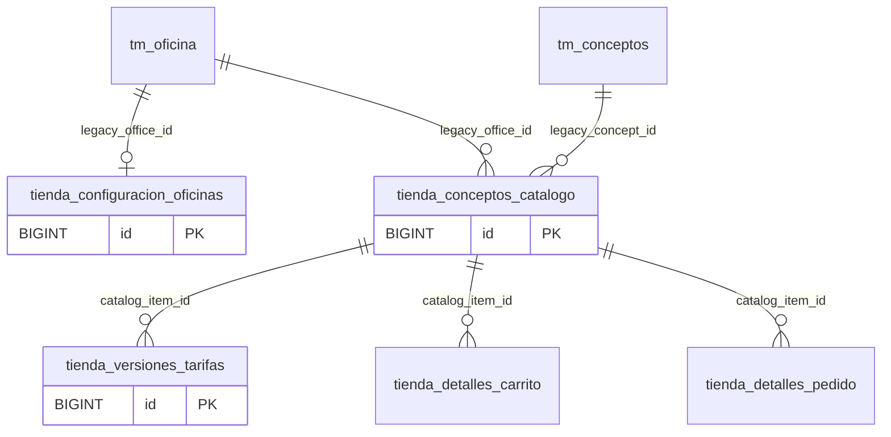

# 2. Catálogo

Oficinas publicadas, conceptos y versiones de tarifa. Tablas del módulo en el esquema MariaDB compartido.

Las tablas externas enlazadas aparecen solo como referencias para interpretar claves foráneas; la propiedad permanece en su módulo correspondiente. Los campos completos deben revisarse en las migraciones y en MariaDB; este ER resume las PK y relaciones, no todos los atributos. 

[Volver al mapa general](./00_MAPA_GENERAL_43_TABLAS.md)
