# Diagrama ER integral de 38 tablas

Vista integral basada en 47 FK documentadas. Las tablas sin FK se representan sin relaciones inventadas. `migrations` queda pendiente de cotejo con DDL instalado.

```mermaid
erDiagram
  tm_oficina {
    INT oficina_id PK
  }
  tm_rol {
    INT rol_id PK
  }
  tm_usuario {
    INT usu_id PK
  }
  tm_conceptos {
    INT id_concepto PK
  }
  tm_recaudacion {
    INT id_recaudacion PK
  }
  tm_resultado {
    INT i_resultado PK
  }
  store_customer_profiles {
    VARCHAR id PK
  }
  store_oauth_identities {
    VARCHAR id PK
  }
  store_beneficiaries {
    VARCHAR id PK
  }
  store_office_settings {
    VARCHAR id PK
  }
  store_catalog_items {
    VARCHAR id PK
  }
  store_catalog_price_versions {
    VARCHAR id PK
  }
  store_carts {
    VARCHAR id PK
  }
  store_cart_items {
    VARCHAR id PK
  }
  store_orders {
    VARCHAR id PK
  }
  store_order_items {
    VARCHAR id PK
  }
  store_order_status_history {
    VARCHAR id PK
  }
  store_payment_attempts {
    VARCHAR id PK
  }
  store_payment_transactions {
    VARCHAR id PK
  }
  store_order_payment_claims {
    VARCHAR id PK
  }
  store_payment_webhook_events {
    VARCHAR id PK
  }
  store_payment_incidents {
    VARCHAR id PK
  }
  store_refunds {
    VARCHAR id PK
  }
  store_reconciliation_batches {
    VARCHAR id PK
  }
  store_reconciliation_entries {
    VARCHAR id PK
  }
  store_external_system_links {
    VARCHAR id PK
  }
  store_payment_validations {
    VARCHAR id PK
  }
  store_validation_certificates {
    VARCHAR id PK
  }
  store_audit_events {
    VARCHAR id PK
  }
  users {
    VARCHAR id PK
  }
  password_reset_tokens {
    VARCHAR email PK
  }
  sessions {
    VARCHAR id PK
  }
  cache {
    VARCHAR key PK
  }
  cache_locks {
    VARCHAR key PK
  }
  jobs {
    VARCHAR id PK
  }
  job_batches {
    VARCHAR id PK
  }
  failed_jobs {
    VARCHAR id PK
  }
  migrations {
    VARCHAR id PK
  }
  users ||--o| store_customer_profiles : "user_id"
  users ||--o{ store_oauth_identities : "user_id"
  store_customer_profiles ||--o{ store_beneficiaries : "customer_profile_id"
  tm_oficina ||--o| store_office_settings : "legacy_office_id"
  tm_oficina ||--o{ store_catalog_items : "legacy_office_id"
  tm_conceptos ||--o{ store_catalog_items : "legacy_concept_id"
  store_catalog_items ||--o{ store_catalog_price_versions : "catalog_item_id"
  users ||--o{ store_carts : "user_id nullable"
  store_carts ||--o{ store_cart_items : "cart_id"
  store_catalog_items ||--o{ store_cart_items : "catalog_item_id"
  store_beneficiaries ||--o{ store_cart_items : "beneficiary_id nullable"
  users ||--o{ store_orders : "user_id"
  store_carts ||--o{ store_orders : "cart_id nullable"
  store_orders ||--o{ store_order_items : "order_id"
  store_catalog_items ||--o{ store_order_items : "catalog_item_id"
  store_beneficiaries ||--o{ store_order_items : "beneficiary_id nullable"
  tm_oficina ||--o{ store_order_items : "legacy_office_id"
  tm_conceptos ||--o{ store_order_items : "legacy_concept_id"
  store_orders ||--o{ store_order_status_history : "order_id"
  users ||--o{ store_order_status_history : "actor_user_id nullable"
  store_orders ||--o{ store_payment_attempts : "order_id"
  store_orders ||--o{ store_payment_transactions : "order_id"
  store_payment_attempts ||--o{ store_payment_transactions : "payment_attempt_id nullable"
  store_orders ||--o| store_order_payment_claims : "order_id"
  store_payment_transactions ||--o| store_order_payment_claims : "payment_transaction_id"
  store_payment_attempts ||--o{ store_payment_webhook_events : "payment_attempt_id nullable"
  store_orders ||--o{ store_payment_incidents : "order_id"
  store_payment_transactions ||--o{ store_payment_incidents : "payment_transaction_id nullable"
  users ||--o{ store_payment_incidents : "resolved_by nullable"
  store_payment_transactions ||--o{ store_refunds : "payment_transaction_id"
  users ||--o{ store_refunds : "requested_by nullable"
  tm_usuario ||--o{ store_reconciliation_batches : "legacy_importer_id nullable"
  store_reconciliation_batches ||--o{ store_reconciliation_entries : "reconciliation_batch_id"
  store_payment_transactions ||--o{ store_reconciliation_entries : "payment_transaction_id nullable"
  tm_resultado ||--o{ store_reconciliation_entries : "legacy_result_id nullable"
  tm_recaudacion ||--o{ store_reconciliation_entries : "legacy_recaudacion_id nullable"
  store_orders ||--o{ store_external_system_links : "order_id nullable"
  store_payment_transactions ||--o{ store_external_system_links : "payment_transaction_id nullable"
  store_orders ||--o{ store_payment_validations : "order_id"
  store_payment_transactions ||--o{ store_payment_validations : "payment_transaction_id"
  tm_usuario ||--o{ store_payment_validations : "legacy_reviewer_id nullable"
  store_payment_validations ||--o| store_validation_certificates : "payment_validation_id"
  store_orders ||--o{ store_validation_certificates : "order_id"
  tm_usuario ||--o{ store_validation_certificates : "legacy_issuer_id nullable"
  tm_usuario ||--o{ store_validation_certificates : "legacy_revoker_id nullable"
  users ||--o{ store_audit_events : "actor_buyer_user_id nullable"
  tm_usuario ||--o{ store_audit_events : "legacy_staff_id nullable"
```

**Nota:** FK nullable aparece etiquetada y las conexiones hacia SISPAGOS provienen de la migración 000005. Esta es una vista de claves, no el diccionario de todas las columnas.

[Mapa](./MAPA_38_TABLAS.md) · [Matriz](./MATRIZ_CARDINALIDADES.md) · [Módulos](./README.md)
