# Mapa integral de 38 tablas — OTI UNDC

> Vista navegable de las 38 entidades; diagramas detallados en `README.md` y módulos. Los enlaces siguen siendo lógicos dentro de una misma base MariaDB.

## Leyenda de dominios
- SISPAGOS: gris `#CBD5E1`, maestros institucionales.
- Tienda: verde `#BBF7D0`, transacciones, catálogo, conciliación.
- Seguridad: morado `#DDD6FE`, compradores y perfiles.
- Infraestructura: neutro `#E5E7EB`, tablas técnicas.

## Vista de agrupación Mermaid (38 tablas)

```mermaid
flowchart LR
  subgraph S["SISPAGOS · 6 (histórico)"]
    L0["tm_oficina"]
    L1["tm_rol"]
    L2["tm_usuario"]
    L3["tm_conceptos"]
    L4["tm_recaudacion"]
    L5["tm_resultado"]
  end
  subgraph T["TIENDA · 23 (seis dominios)"]
    T0["store_customer_profiles"]
    T1["store_oauth_identities"]
    T2["store_beneficiaries"]
    T3["store_office_settings"]
    T4["store_catalog_items"]
    T5["store_catalog_price_versions"]
    T6["store_carts"]
    T7["store_cart_items"]
    T8["store_orders"]
    T9["store_order_items"]
    T10["store_order_status_history"]
    T11["store_payment_attempts"]
    T12["store_payment_transactions"]
    T13["store_order_payment_claims"]
    T14["store_payment_webhook_events"]
    T15["store_payment_incidents"]
    T16["store_refunds"]
    T17["store_reconciliation_batches"]
    T18["store_reconciliation_entries"]
    T19["store_external_system_links"]
    T20["store_payment_validations"]
    T21["store_validation_certificates"]
    T22["store_audit_events"]
  end
  subgraph I["INFRAESTRUCTURA · 9"]
    I0["users"]
    I1["password_reset_tokens"]
    I2["sessions"]
    I3["cache"]
    I4["cache_locks"]
    I5["jobs"]
    I6["job_batches"]
    I7["failed_jobs"]
    I8["migrations"]
  end
  class L0 legado
  class L1 legado
  class L2 legado
  class L3 legado
  class L4 legado
  class L5 legado
  class T0 tienda
  class T1 tienda
  class T2 tienda
  class T3 tienda
  class T4 tienda
  class T5 tienda
  class T6 tienda
  class T7 tienda
  class T8 tienda
  class T9 tienda
  class T10 tienda
  class T11 tienda
  class T12 tienda
  class T13 tienda
  class T14 tienda
  class T15 tienda
  class T16 tienda
  class T17 tienda
  class T18 tienda
  class T19 tienda
  class T20 tienda
  class T21 tienda
  class T22 tienda
  class I0 infraestructura
  class I1 infraestructura
  class I2 infraestructura
  class I3 infraestructura
  class I4 infraestructura
  class I5 infraestructura
  class I6 infraestructura
  class I7 infraestructura
  class I8 infraestructura
  classDef legado fill:#CBD5E1,stroke:#64748B,color:#111827
  classDef tienda fill:#BBF7D0,stroke:#15803D,color:#14532D
  class I0 seguridad
  class T0 seguridad
  class T1 seguridad
  class T2 seguridad
  classDef seguridad fill:#DDD6FE,stroke:#7C3AED,color:#3B0764
  classDef infraestructura fill:#E5E7EB,stroke:#9CA3AF,color:#111827
```

## Relaciones físicas SISPAGOS ↔ Tienda (12)

| Origen | Columna | Destino |
|---|---|---|
| `store_office_settings` | `legacy_office_id` | `tm_oficina` |
| `store_catalog_items` | `legacy_office_id` | `tm_oficina` |
| `store_catalog_items` | `legacy_concept_id` | `tm_conceptos` |
| `store_order_items` | `legacy_office_id` | `tm_oficina` |
| `store_order_items` | `legacy_concept_id` | `tm_conceptos` |
| `store_reconciliation_batches` | `legacy_importer_id` | `tm_usuario` |
| `store_reconciliation_entries` | `legacy_result_id` | `tm_resultado` |
| `store_reconciliation_entries` | `legacy_recaudacion_id` | `tm_recaudacion` |
| `store_payment_validations` | `legacy_reviewer_id` | `tm_usuario` |
| `store_validation_certificates` | `legacy_issuer_id` | `tm_usuario` |
| `store_validation_certificates` | `legacy_revoker_id` | `tm_usuario` |
| `store_audit_events` | `legacy_staff_id` | `tm_usuario` |

## Navegación
- [ER detallado de la tienda](./README.md)
- [Diccionario tienda](./DICCIONARIO_DATOS.md)
- [Diccionario Laravel](./DICCIONARIO_LARAVEL.md)
- [Diccionario SISPAGOS (parcial)](./DICCIONARIO_SISPAGOS.md)
- [Observaciones](./REVISION_ESTRUCTURAL.md)

## Límites
La vista de 38 entidades es **mapa de agrupación**, no un ER físico completo: las columnas e índices SISPAGOS vigentes permanecen sin verificar, y no existe una FK histórica acreditada hacia `tm_rol`. Ninguna tabla fue creada ni modificada.

## Lectura del mapa
- Las cajas representan **38 tablas existentes según el informe de desarrollo**; la vista no inventa nuevos esquemas físicos.
- En morado están el comprador web `users` y sus tres extensiones de identidad. `tm_usuario` sigue gris por ser un usuario del sistema institucional, no un comprador.
- Los vínculos relacionales detallados se encuentran en [Matriz de cardinalidades](./MATRIZ_CARDINALIDADES.md). Esta vista visual privilegia legibilidad por áreas.
- Los criterios de **tarifas, permisos, conciliación y emisión** se reservan para una etapa posterior; aquí no se aprueban políticas funcionales.
