# Matriz de cardinalidad de FK — 23 tablas de tienda

Fuente: 4 migraciones de tablas `store_*` y la quinta migración de integración histórica. Relación **hijo → padre**. Cada fila de hijo apunta a 1 padre si NOT NULL y a 0..1 si nullable. Visto desde el padre, pueden existir 0..N hijos o 0..1 cuando la columna del hijo tiene UNIQUE individual.

**Importante:** los UNIQUE compuestos y la unicidad de columnas no-FK no se confunden con cardinalidad 1:1. La notación representa la restricción de esquema, no la existencia actual de registros.

| Tabla hija | FK | Tabla padre | Padre por hijo | Hijos por padre | Origen |
|---|---|---|---|---|---|
| `store_customer_profiles` | `user_id` | `users` | 1 | 0..1 | Migración tienda |
| `store_oauth_identities` | `user_id` | `users` | 1 | 0..N | Migración tienda |
| `store_beneficiaries` | `customer_profile_id` | `store_customer_profiles` | 1 | 0..N | Migración tienda |
| `store_office_settings` | `legacy_office_id` | `tm_oficina` | 1 | 0..1 | Integración SISPAGOS |
| `store_catalog_items` | `legacy_office_id` | `tm_oficina` | 1 | 0..N | Integración SISPAGOS |
| `store_catalog_items` | `legacy_concept_id` | `tm_conceptos` | 1 | 0..N | Integración SISPAGOS |
| `store_catalog_price_versions` | `catalog_item_id` | `store_catalog_items` | 1 | 0..N | Migración tienda |
| `store_carts` | `user_id` | `users` | 0..1 | 0..N | Migración tienda |
| `store_cart_items` | `cart_id` | `store_carts` | 1 | 0..N | Migración tienda |
| `store_cart_items` | `catalog_item_id` | `store_catalog_items` | 1 | 0..N | Migración tienda |
| `store_cart_items` | `beneficiary_id` | `store_beneficiaries` | 0..1 | 0..N | Migración tienda |
| `store_orders` | `user_id` | `users` | 1 | 0..N | Migración tienda |
| `store_orders` | `cart_id` | `store_carts` | 0..1 | 0..N | Migración tienda |
| `store_order_items` | `order_id` | `store_orders` | 1 | 0..N | Migración tienda |
| `store_order_items` | `catalog_item_id` | `store_catalog_items` | 1 | 0..N | Migración tienda |
| `store_order_items` | `beneficiary_id` | `store_beneficiaries` | 0..1 | 0..N | Migración tienda |
| `store_order_items` | `legacy_office_id` | `tm_oficina` | 1 | 0..N | Integración SISPAGOS |
| `store_order_items` | `legacy_concept_id` | `tm_conceptos` | 1 | 0..N | Integración SISPAGOS |
| `store_order_status_history` | `order_id` | `store_orders` | 1 | 0..N | Migración tienda |
| `store_order_status_history` | `actor_user_id` | `users` | 0..1 | 0..N | Migración tienda |
| `store_payment_attempts` | `order_id` | `store_orders` | 1 | 0..N | Migración tienda |
| `store_payment_transactions` | `order_id` | `store_orders` | 1 | 0..N | Migración tienda |
| `store_payment_transactions` | `payment_attempt_id` | `store_payment_attempts` | 0..1 | 0..N | Migración tienda |
| `store_order_payment_claims` | `order_id` | `store_orders` | 1 | 0..1 | Migración tienda |
| `store_order_payment_claims` | `payment_transaction_id` | `store_payment_transactions` | 1 | 0..1 | Migración tienda |
| `store_payment_webhook_events` | `payment_attempt_id` | `store_payment_attempts` | 0..1 | 0..N | Migración tienda |
| `store_payment_incidents` | `order_id` | `store_orders` | 1 | 0..N | Migración tienda |
| `store_payment_incidents` | `payment_transaction_id` | `store_payment_transactions` | 0..1 | 0..N | Migración tienda |
| `store_payment_incidents` | `resolved_by` | `users` | 0..1 | 0..N | Migración tienda |
| `store_refunds` | `payment_transaction_id` | `store_payment_transactions` | 1 | 0..N | Migración tienda |
| `store_refunds` | `requested_by` | `users` | 0..1 | 0..N | Migración tienda |
| `store_reconciliation_batches` | `legacy_importer_id` | `tm_usuario` | 0..1 | 0..N | Integración SISPAGOS |
| `store_reconciliation_entries` | `reconciliation_batch_id` | `store_reconciliation_batches` | 1 | 0..N | Migración tienda |
| `store_reconciliation_entries` | `payment_transaction_id` | `store_payment_transactions` | 0..1 | 0..N | Migración tienda |
| `store_reconciliation_entries` | `legacy_result_id` | `tm_resultado` | 0..1 | 0..N | Integración SISPAGOS |
| `store_reconciliation_entries` | `legacy_recaudacion_id` | `tm_recaudacion` | 0..1 | 0..N | Integración SISPAGOS |
| `store_external_system_links` | `order_id` | `store_orders` | 0..1 | 0..N | Migración tienda |
| `store_external_system_links` | `payment_transaction_id` | `store_payment_transactions` | 0..1 | 0..N | Migración tienda |
| `store_payment_validations` | `order_id` | `store_orders` | 1 | 0..N | Migración tienda |
| `store_payment_validations` | `payment_transaction_id` | `store_payment_transactions` | 1 | 0..N | Migración tienda |
| `store_payment_validations` | `legacy_reviewer_id` | `tm_usuario` | 0..1 | 0..N | Integración SISPAGOS |
| `store_validation_certificates` | `payment_validation_id` | `store_payment_validations` | 1 | 0..1 | Migración tienda |
| `store_validation_certificates` | `order_id` | `store_orders` | 1 | 0..N | Migración tienda |
| `store_validation_certificates` | `legacy_issuer_id` | `tm_usuario` | 0..1 | 0..N | Integración SISPAGOS |
| `store_validation_certificates` | `legacy_revoker_id` | `tm_usuario` | 0..1 | 0..N | Integración SISPAGOS |
| `store_audit_events` | `actor_buyer_user_id` | `users` | 0..1 | 0..N | Migración tienda |
| `store_audit_events` | `legacy_staff_id` | `tm_usuario` | 0..1 | 0..N | Integración SISPAGOS |

**Precauciones:** `sessions.user_id` tiene índice y no FK; no figura como relación física. `tm_usuario.rol_id`, `tm_usuario.oficina_id` y `tm_conceptos.centro_costo` no son FK demostradas. `store_external_system_links.legacy_record_id` es enlace polimórfico sin FK.

## ER de FK entre las 23 tiendas y maestros históricos

```mermaid
erDiagram
  users ||--o| store_customer_profiles : "user_id"
  users ||--o{ store_oauth_identities : "user_id"
  store_customer_profiles ||--o{ store_beneficiaries : "customer_profile_id"
  tm_oficina ||--o| store_office_settings : "legacy_office_id"
  tm_oficina ||--o{ store_catalog_items : "legacy_office_id"
  tm_conceptos ||--o{ store_catalog_items : "legacy_concept_id"
  store_catalog_items ||--o{ store_catalog_price_versions : "catalog_item_id"
  users o|--o{ store_carts : "user_id"
  store_carts ||--o{ store_cart_items : "cart_id"
  store_catalog_items ||--o{ store_cart_items : "catalog_item_id"
  store_beneficiaries o|--o{ store_cart_items : "beneficiary_id"
  users ||--o{ store_orders : "user_id"
  store_carts o|--o{ store_orders : "cart_id"
  store_orders ||--o{ store_order_items : "order_id"
  store_catalog_items ||--o{ store_order_items : "catalog_item_id"
  store_beneficiaries o|--o{ store_order_items : "beneficiary_id"
  tm_oficina ||--o{ store_order_items : "legacy_office_id"
  tm_conceptos ||--o{ store_order_items : "legacy_concept_id"
  store_orders ||--o{ store_order_status_history : "order_id"
  users o|--o{ store_order_status_history : "actor_user_id"
  store_orders ||--o{ store_payment_attempts : "order_id"
  store_orders ||--o{ store_payment_transactions : "order_id"
  store_payment_attempts o|--o{ store_payment_transactions : "payment_attempt_id"
  store_orders ||--o| store_order_payment_claims : "order_id"
  store_payment_transactions ||--o| store_order_payment_claims : "payment_transaction_id"
  store_payment_attempts o|--o{ store_payment_webhook_events : "payment_attempt_id"
  store_orders ||--o{ store_payment_incidents : "order_id"
  store_payment_transactions o|--o{ store_payment_incidents : "payment_transaction_id"
  users o|--o{ store_payment_incidents : "resolved_by"
  store_payment_transactions ||--o{ store_refunds : "payment_transaction_id"
  users o|--o{ store_refunds : "requested_by"
  tm_usuario o|--o{ store_reconciliation_batches : "legacy_importer_id"
  store_reconciliation_batches ||--o{ store_reconciliation_entries : "reconciliation_batch_id"
  store_payment_transactions o|--o{ store_reconciliation_entries : "payment_transaction_id"
  tm_resultado o|--o{ store_reconciliation_entries : "legacy_result_id"
  tm_recaudacion o|--o{ store_reconciliation_entries : "legacy_recaudacion_id"
  store_orders o|--o{ store_external_system_links : "order_id"
  store_payment_transactions o|--o{ store_external_system_links : "payment_transaction_id"
  store_orders ||--o{ store_payment_validations : "order_id"
  store_payment_transactions ||--o{ store_payment_validations : "payment_transaction_id"
  tm_usuario o|--o{ store_payment_validations : "legacy_reviewer_id"
  store_payment_validations ||--o| store_validation_certificates : "payment_validation_id"
  store_orders ||--o{ store_validation_certificates : "order_id"
  tm_usuario o|--o{ store_validation_certificates : "legacy_issuer_id"
  tm_usuario o|--o{ store_validation_certificates : "legacy_revoker_id"
  users o|--o{ store_audit_events : "actor_buyer_user_id"
  tm_usuario o|--o{ store_audit_events : "legacy_staff_id"
```

Esta vista de relaciones, sin campos, complementa el ER detallado y facilita auditar conexiones entre módulos. Para legibilidad, consultar además los seis ER por módulo.