# Modelo relacional modular — Tienda UNDC

> Modelo documental generado desde las migraciones existentes; no implica cambios a la base instalada.

## Dominios y convenciones
SISPAGOS (gris), tienda (verde), identidad/seguridad (morado), infraestructura (neutro). Mermaid ER representa relaciones físicas identificadas; referencias opcionales se aclaran en el diccionario.

## Tablas históricas
Las seis tablas `tm_*` se conservan sin modificaciones. La relación lógica entre `tm_usuario`, `tm_rol` y `tm_oficina` no equivale a FK histórica declarada. Los compradores `users` no son funcionarios `tm_usuario`.

### identidad
`store_customer_profiles`, `store_oauth_identities`, `store_beneficiaries`

### catalogo
`store_office_settings`, `store_catalog_items`, `store_catalog_price_versions`

### pedidos
`store_carts`, `store_cart_items`, `store_orders`, `store_order_items`, `store_order_status_history`

### pagos
`store_payment_attempts`, `store_payment_transactions`, `store_order_payment_claims`, `store_payment_webhook_events`, `store_payment_incidents`, `store_refunds`

### conciliacion
`store_reconciliation_batches`, `store_reconciliation_entries`

### control
`store_external_system_links`, `store_payment_validations`, `store_validation_certificates`, `store_audit_events`

## Diagrama general — 23 tablas

```mermaid
erDiagram
  store_customer_profiles {
BIGINT id PK
BIGINT user_id FK
VARCHAR first_names
VARCHAR last_names
VARCHAR document_type
VARCHAR document_number
VARCHAR phone
VARCHAR contact_email
TIMESTAMP created_at
TIMESTAMP updated_at
  }
  store_oauth_identities {
BIGINT id PK
BIGINT user_id FK
VARCHAR provider
VARCHAR provider_subject
TIMESTAMP created_at
TIMESTAMP updated_at
  }
  store_beneficiaries {
BIGINT id PK
BIGINT customer_profile_id FK
VARCHAR first_names
VARCHAR last_names
VARCHAR document_type
VARCHAR document_number
VARCHAR email
VARCHAR phone
TIMESTAMP created_at
TIMESTAMP updated_at
  }
  store_office_settings {
BIGINT id PK
INT legacy_office_id FK
VARCHAR slug
BOOLEAN catalog_enabled
VARCHAR display_name
TIMESTAMP created_at
TIMESTAMP updated_at
  }
  store_catalog_items {
BIGINT id PK
INT legacy_concept_id FK
INT legacy_office_id FK
VARCHAR slug
TEXT description
TEXT requirements
VARCHAR category
BOOLEAN requires_eligibility_check
BOOLEAN is_published
TIMESTAMP created_at
TIMESTAMP updated_at
  }
  store_catalog_price_versions {
BIGINT id PK
BIGINT catalog_item_id FK
DECIMAL amount
CHAR currency
TIMESTAMP valid_from
TIMESTAMP valid_until
VARCHAR approval_reference
BOOLEAN is_approved
TIMESTAMP created_at
TIMESTAMP updated_at
  }
  store_carts {
BIGINT id PK
BIGINT user_id FK
CHAR token_hash
CHAR currency
VARCHAR status
TIMESTAMP expires_at
TIMESTAMP created_at
TIMESTAMP updated_at
  }
  store_cart_items {
BIGINT id PK
BIGINT cart_id FK
BIGINT catalog_item_id FK
BIGINT beneficiary_id FK
INT quantity
TIMESTAMP created_at
TIMESTAMP updated_at
  }
  store_orders {
BIGINT id PK
VARCHAR code
BIGINT user_id FK
BIGINT cart_id FK
VARCHAR status
CHAR currency
DECIMAL total_amount
VARCHAR buyer_first_names
VARCHAR buyer_last_names
VARCHAR buyer_document_type
VARCHAR buyer_document_number
VARCHAR buyer_email
VARCHAR buyer_phone
TIMESTAMP expires_at
TIMESTAMP confirmed_at
TIMESTAMP paid_at
TIMESTAMP cancelled_at
TIMESTAMP created_at
TIMESTAMP updated_at
  }
  store_order_items {
BIGINT id PK
BIGINT order_id FK
BIGINT catalog_item_id FK
INT legacy_concept_id FK
INT legacy_office_id FK
BIGINT beneficiary_id FK
VARCHAR concept_code
VARCHAR concept_name
INT quantity
DECIMAL unit_amount
DECIMAL total_amount
VARCHAR beneficiary_first_names
VARCHAR beneficiary_last_names
VARCHAR beneficiary_document_type
VARCHAR beneficiary_document_number
TIMESTAMP created_at
TIMESTAMP updated_at
  }
  store_order_status_history {
BIGINT id PK
BIGINT order_id FK
BIGINT actor_user_id FK
VARCHAR from_status
VARCHAR to_status
VARCHAR reason
JSON context
TIMESTAMP occurred_at
  }
  store_payment_attempts {
BIGINT id PK
BIGINT order_id FK
VARCHAR channel
VARCHAR provider
VARCHAR status
VARCHAR idempotency_key
VARCHAR provider_session_reference
DECIMAL requested_amount
CHAR currency
TIMESTAMP started_at
TIMESTAMP finished_at
JSON non_sensitive_metadata
TIMESTAMP created_at
TIMESTAMP updated_at
  }
  store_payment_transactions {
BIGINT id PK
BIGINT order_id FK
BIGINT payment_attempt_id FK
VARCHAR provider
VARCHAR provider_transaction_reference
VARCHAR status
DECIMAL amount
CHAR currency
VARCHAR verification_source
TIMESTAMP observed_at
TIMESTAMP verified_at
TIMESTAMP settled_at
CHAR evidence_digest
TIMESTAMP created_at
TIMESTAMP updated_at
  }
  store_order_payment_claims {
BIGINT id PK
BIGINT order_id FK
BIGINT payment_transaction_id FK
TIMESTAMP claimed_at
  }
  store_payment_webhook_events {
BIGINT id PK
VARCHAR provider
VARCHAR event_key
BIGINT payment_attempt_id FK
VARCHAR processing_status
BOOLEAN signature_valid
CHAR payload_digest
TIMESTAMP received_at
TIMESTAMP processed_at
VARCHAR failure_reason
TIMESTAMP created_at
TIMESTAMP updated_at
  }
  store_payment_incidents {
BIGINT id PK
BIGINT order_id FK
BIGINT payment_transaction_id FK
VARCHAR kind
VARCHAR status
TEXT description
BIGINT resolved_by FK
TIMESTAMP resolved_at
TIMESTAMP created_at
TIMESTAMP updated_at
  }
  store_refunds {
BIGINT id PK
BIGINT payment_transaction_id FK
VARCHAR provider_refund_reference
DECIMAL amount
CHAR currency
VARCHAR status
VARCHAR reason
BIGINT requested_by FK
TIMESTAMP requested_at
TIMESTAMP completed_at
TIMESTAMP created_at
TIMESTAMP updated_at
  }
  store_reconciliation_batches {
BIGINT id PK
VARCHAR provider
VARCHAR channel
VARCHAR external_batch_reference
CHAR source_file_digest
VARCHAR status
DATE period_from
DATE period_until
DECIMAL reported_total
CHAR currency
INT legacy_importer_id FK
TIMESTAMP reconciled_at
TIMESTAMP created_at
TIMESTAMP updated_at
  }
  store_reconciliation_entries {
BIGINT id PK
BIGINT reconciliation_batch_id FK
INT row_number
INT legacy_result_id FK
INT legacy_recaudacion_id FK
BIGINT payment_transaction_id FK
VARCHAR external_payment_reference
VARCHAR debtor_code
VARCHAR concept_code
VARCHAR installment_reference
DECIMAL gross_amount
DECIMAL fee_amount
DECIMAL net_amount
CHAR currency
VARCHAR status
TIMESTAMP bank_operation_at
TIMESTAMP matched_at
TIMESTAMP created_at
TIMESTAMP updated_at
  }
  store_external_system_links {
BIGINT id PK
VARCHAR system_code
VARCHAR external_entity
VARCHAR external_record_key
INT legacy_record_id
BIGINT order_id FK
BIGINT payment_transaction_id FK
VARCHAR sync_status
TIMESTAMP last_synced_at
TIMESTAMP created_at
TIMESTAMP updated_at
  }
  store_payment_validations {
BIGINT id PK
BIGINT order_id FK
BIGINT payment_transaction_id FK
INT legacy_reviewer_id FK
VARCHAR status
VARCHAR evidence_reference
VARCHAR decision_reason
TIMESTAMP reviewed_at
TIMESTAMP created_at
TIMESTAMP updated_at
  }
  store_validation_certificates {
BIGINT id PK
BIGINT payment_validation_id FK
BIGINT order_id FK
VARCHAR certificate_code
CHAR verification_token_hash
VARCHAR status
INT legacy_issuer_id FK
TIMESTAMP issued_at
INT legacy_revoker_id FK
TIMESTAMP revoked_at
VARCHAR revocation_reason
TIMESTAMP created_at
TIMESTAMP updated_at
  }
  store_audit_events {
BIGINT id PK
BIGINT actor_buyer_user_id FK
INT legacy_staff_id FK
VARCHAR event_name
VARCHAR subject_type
VARCHAR correlation_id
JSON safe_context
TIMESTAMP occurred_at
  }
  store_customer_profiles ||--o{ store_beneficiaries : "customer_profile_id"
  store_catalog_items ||--o{ store_catalog_price_versions : "catalog_item_id"
  store_carts ||--o{ store_cart_items : "cart_id"
  store_catalog_items ||--o{ store_cart_items : "catalog_item_id"
  store_beneficiaries ||--o{ store_cart_items : "beneficiary_id"
  store_carts ||--o{ store_orders : "cart_id"
  store_orders ||--o{ store_order_items : "order_id"
  store_catalog_items ||--o{ store_order_items : "catalog_item_id"
  store_beneficiaries ||--o{ store_order_items : "beneficiary_id"
  store_orders ||--o{ store_order_status_history : "order_id"
  store_orders ||--o{ store_payment_attempts : "order_id"
  store_orders ||--o{ store_payment_transactions : "order_id"
  store_payment_attempts ||--o{ store_payment_transactions : "payment_attempt_id"
  store_orders ||--o{ store_order_payment_claims : "order_id"
  store_payment_transactions ||--o{ store_order_payment_claims : "payment_transaction_id"
  store_payment_attempts ||--o{ store_payment_webhook_events : "payment_attempt_id"
  store_orders ||--o{ store_payment_incidents : "order_id"
  store_payment_transactions ||--o{ store_payment_incidents : "payment_transaction_id"
  store_payment_transactions ||--o{ store_refunds : "payment_transaction_id"
  store_reconciliation_batches ||--o{ store_reconciliation_entries : "reconciliation_batch_id"
  store_payment_transactions ||--o{ store_reconciliation_entries : "payment_transaction_id"
  store_orders ||--o{ store_external_system_links : "order_id"
  store_payment_transactions ||--o{ store_external_system_links : "payment_transaction_id"
  store_orders ||--o{ store_payment_validations : "order_id"
  store_payment_transactions ||--o{ store_payment_validations : "payment_transaction_id"
  store_payment_validations ||--o{ store_validation_certificates : "payment_validation_id"
  store_orders ||--o{ store_validation_certificates : "order_id"
  style store_customer_profiles fill:#DDD6FE,stroke:#15803D,color:#111827
  style store_oauth_identities fill:#DDD6FE,stroke:#15803D,color:#111827
  style store_beneficiaries fill:#DDD6FE,stroke:#15803D,color:#111827
  style store_office_settings fill:#BBF7D0,stroke:#15803D,color:#111827
  style store_catalog_items fill:#BBF7D0,stroke:#15803D,color:#111827
  style store_catalog_price_versions fill:#BBF7D0,stroke:#15803D,color:#111827
  style store_carts fill:#BBF7D0,stroke:#15803D,color:#111827
  style store_cart_items fill:#BBF7D0,stroke:#15803D,color:#111827
  style store_orders fill:#BBF7D0,stroke:#15803D,color:#111827
  style store_order_items fill:#BBF7D0,stroke:#15803D,color:#111827
  style store_order_status_history fill:#BBF7D0,stroke:#15803D,color:#111827
  style store_payment_attempts fill:#BBF7D0,stroke:#15803D,color:#111827
  style store_payment_transactions fill:#BBF7D0,stroke:#15803D,color:#111827
  style store_order_payment_claims fill:#BBF7D0,stroke:#15803D,color:#111827
  style store_payment_webhook_events fill:#BBF7D0,stroke:#15803D,color:#111827
  style store_payment_incidents fill:#BBF7D0,stroke:#15803D,color:#111827
  style store_refunds fill:#BBF7D0,stroke:#15803D,color:#111827
  style store_reconciliation_batches fill:#BBF7D0,stroke:#15803D,color:#111827
  style store_reconciliation_entries fill:#BBF7D0,stroke:#15803D,color:#111827
  style store_external_system_links fill:#BBF7D0,stroke:#15803D,color:#111827
  style store_payment_validations fill:#BBF7D0,stroke:#15803D,color:#111827
  style store_validation_certificates fill:#BBF7D0,stroke:#15803D,color:#111827
  style store_audit_events fill:#BBF7D0,stroke:#15803D,color:#111827
```

## Enlaces físicos con SISPAGOS

| Tabla tienda | Campo | Maestro | PK destino |
|---|---|---|---|
| store_office_settings | legacy_office_id | tm_oficina | oficina_id |
| store_catalog_items | legacy_office_id | tm_oficina | oficina_id |
| store_catalog_items | legacy_concept_id | tm_conceptos | id_concepto |
| store_order_items | legacy_office_id | tm_oficina | oficina_id |
| store_order_items | legacy_concept_id | tm_conceptos | id_concepto |
| store_reconciliation_batches | legacy_importer_id | tm_usuario | usu_id |
| store_reconciliation_entries | legacy_result_id | tm_resultado | i_resultado |
| store_reconciliation_entries | legacy_recaudacion_id | tm_recaudacion | id_recaudacion |
| store_payment_validations | legacy_reviewer_id | tm_usuario | usu_id |
| store_validation_certificates | legacy_issuer_id | tm_usuario | usu_id |
| store_validation_certificates | legacy_revoker_id | tm_usuario | usu_id |
| store_audit_events | legacy_staff_id | tm_usuario | usu_id |

## Diagramas por módulo
- [identidad](./identidad.md)
- [catalogo](./catalogo.md)
- [pedidos](./pedidos.md)
- [pagos](./pagos.md)
- [conciliacion](./conciliacion.md)
- [control](./control.md)

[Diccionario de datos](./DICCIONARIO_DATOS.md) · [Revisión estructural](./REVISION_ESTRUCTURAL.md)

## Inventario general (38 entidades)

Consultar [Mapa de 38 tablas](./MAPA_38_TABLAS.md) para la agrupación visual completa, [Diccionario técnico Laravel](./DICCIONARIO_LARAVEL.md) y [Diccionario histórico SISPAGOS](./DICCIONARIO_SISPAGOS.md). Las 67 columnas históricas identificadas provienen de un fixture CI sanitizado; sigue pendiente compararlas con el DDL institucional vigente autorizado.

## Estado documental
- [Mapa de 38 tablas](./MAPA_38_TABLAS.md), con identidad y seguridad en morado.
- [Diccionario histórico SISPAGOS](./DICCIONARIO_SISPAGOS.md): 67 columnas documentadas desde fixture CI, sin datos privados.
- [Diccionario de infraestructura Laravel](./DICCIONARIO_LARAVEL.md): ocho tablas con DDL de migraciones y `migrations` de control del framework por confirmar.
- [Matriz de cardinalidades](./MATRIZ_CARDINALIDADES.md): 47 relaciones declaradas en la tienda o hacia SISPAGOS.
- **Decisiones aplazadas por indicación del proyecto:** tarifas, roles, permisos, políticas de pagos, conciliación, constancias y demás reglas funcionales.
- No se han ejecutado migraciones, creado endpoints ni modificado `tm_*`, Oracle o main.

## Diagramas de presentación

- [ER integral de las 38 tablas y sus 47 FK](./ER_INTEGRAL_38_TABLAS.md) — lectura general de relaciones.
- [Mapa por dominios](./MAPA_38_TABLAS.md) — más sencillo para exponer.
- [Matriz de cardinalidades](./MATRIZ_CARDINALIDADES.md) — detalle de cada FK.

**Advertencia de presentación:** Mermaid realiza distribución automática, por lo que el ER integral puede verse extenso; para una exposición usar el mapa por dominios junto a los seis diagramas individuales. Las decisiones de tarifas, permisos y otras reglas de negocio permanecen aplazadas.
