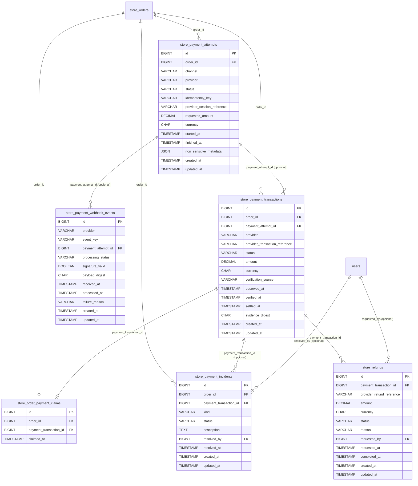

# Diagrama editable — pagos

Vista funcional. Consultar el diagrama general para relaciones externas al módulo.

## Convención de cardinalidades
La relación `||--o{` se representa desde el padre hacia cero o muchos hijos; `||--o|` hacia cero o un hijo (FK individual UNIQUE). Cuando la FK del hijo es nullable se señala **(opcional)**; las relaciones a entidades externas al módulo aparecen como nodos de referencia sin alterar sus estructuras. Consultar [matriz completa](./MATRIZ_CARDINALIDADES.md).

